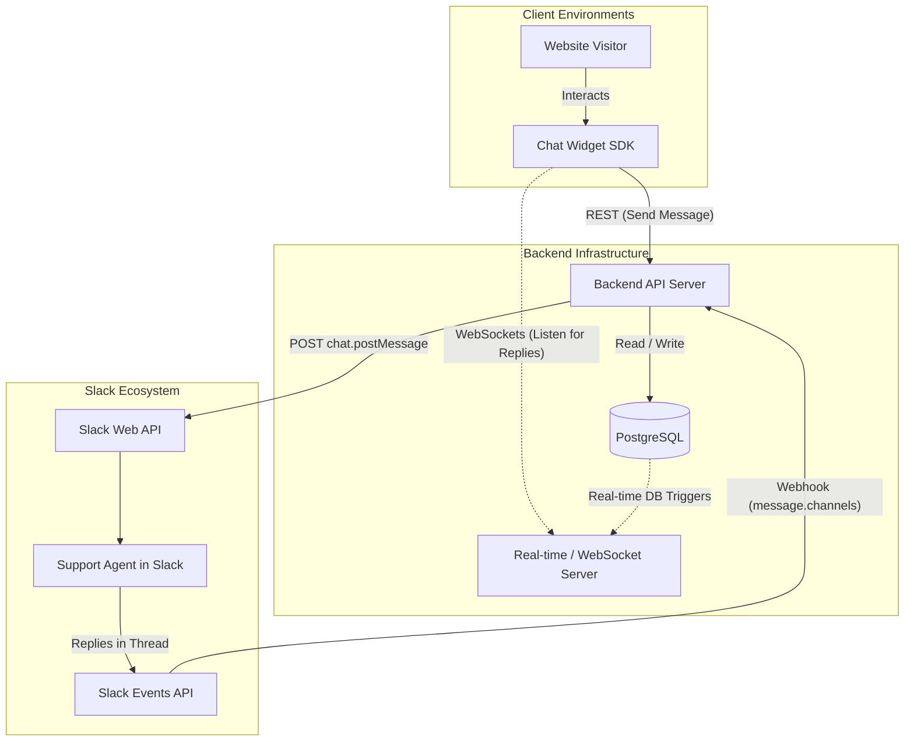
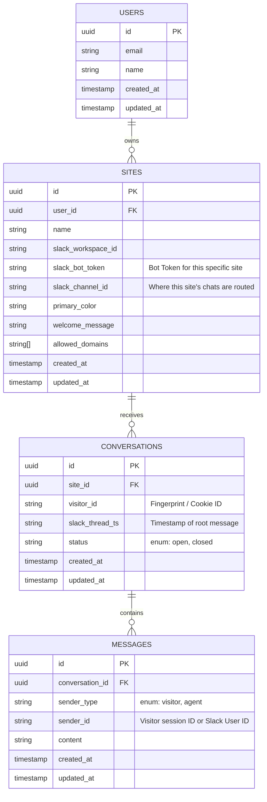
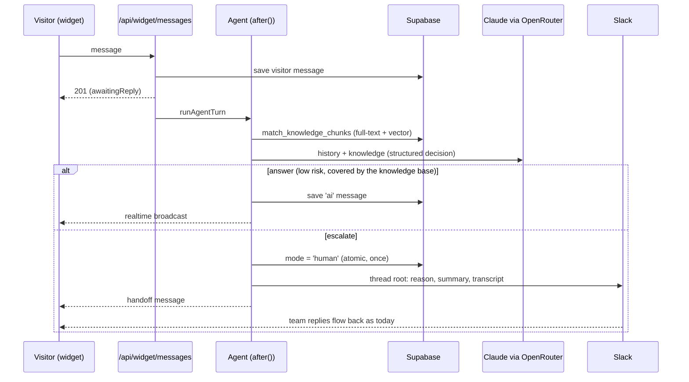

# Technical Product Requirements Document (PRD)
**Project**: Slack-Native Website Chat Platform

## 1. Product Vision & Goals
A lightweight, embeddable website chat widget that routes visitor conversations directly into Slack. It enables two-way, real-time messaging between website visitors and support teams (who remain entirely within Slack), removing the need for a separate customer support dashboard.

**Key Technical Goals:**
- **Widget Performance**: Under 100KB target load size, extremely fast initialization.
- **Real-time Sync**: Instant message delivery between the browser and Slack.
- **Simplicity**: Self-serve Slack OAuth installation flow for site owners.

---

## 2. Tech Stack

| Layer | Technology | Purpose |
|---|---|---|
| **Dashboard & API** | Next.js (App Router) | Admin dashboard UI and backend API Routes |
| **Embeddable Widget** | Vanilla JS / Preact | Lightweight `<script>` tag embed, keeps bundle under 100KB |
| **Database** | Supabase (PostgreSQL) | Persistent storage for sites, conversations, and messages |
| **Real-time** | Supabase Realtime | Pushes new agent messages from DB to the visitor's widget via WebSocket |
| **Authentication** | Supabase Auth | Magic link / email login for dashboard users |
| **Slack Integration** | Slack Web API + Events API | Sends visitor messages to Slack, receives agent replies via webhook |
| **Hosting** | Vercel | Deploys the Next.js app; `public/widget.js` is served via Vercel's Edge CDN |
| **Styling** | Tailwind CSS | Dashboard UI styling |

---

## 3. Technical Architecture

The system consists of three main components:
1. **Embeddable Widget (Frontend)**: A lightweight Javascript/React component injected via a `<script>` tag.
2. **Backend Application**: The core API server handling widget requests, database interactions, and Slack webhooks.
3. **Slack Platform Integrations**: Slack OAuth for installation, Web API for sending messages, and Events API for receiving agent replies.

### System Architecture Diagram

---

## 4. Database Schema (Simplified Per-User Model)

We are using a streamlined schema: 1 User -> N Sites. Each Site acts as the container for the widget configuration, Slack Bot token, and chat routing.

### Entity Relationship Diagram

### Table Definitions
*   **`users`**: Individual dashboard users (e.g., Indie Hackers, Founders).
*   **`sites`**: A combined entity representing the website, its widget settings, and its Slack integration. If a user has two websites, they will create two `sites` records and authorize the Slack bot twice (once for each site).
*   **`conversations`**: Support threads tied to a specific site. Maps a unique visitor to a specific `thread_ts` in a Slack channel.
*   **`messages`**: Individual chat messages. Differentiated by `sender_type` (`visitor`, `agent` for a human in Slack, `ai` for the AI agent). `metadata` stores the agent's decision, risk level and the chunks it used.
*   **`knowledge_sources`**: A site's knowledge base entries: web links (one page or a same-site crawl of up to 20 pages), uploaded documents (PDF, DOCX, TXT, Markdown in the private `knowledge-files` Storage bucket) and pasted text. `active_version` points at the live version.
*   **`knowledge_pages`** / **`knowledge_chunks`**: The fetched pages/documents and their chunks, per version. Chunks carry a content hash, a generated full-text `tsvector`, and a pgvector embedding (1024 dims) with the model that produced it.
*   **`knowledge_jobs`**: The ingestion queue (one live job per source), consumed by the ingest worker.
*   **`knowledge_conflicts`**: Pairs of near-identical passages from different sources that say different things (e.g. an old PDF and an updated page), shown in the dashboard.

All fixed value sets are Postgres enums (`conversation_mode`, `message_sender_type`, `escalation_reason`, `knowledge_source_type`, ...), mirrored in `lib/types/enums.ts` and `services/ingest-worker/src/ingest_worker/enums.py`.

---

## 5. API & Integration Endpoints

### 4.1 Client-Facing API (Widget)
*   `GET /api/widget/config?site_id={id}`: Fetch widget settings.
*   `POST /api/widget/conversations`: Initialize a new conversation.
*   `POST /api/widget/messages`: Send a new message from the visitor.

*   `GET /api/widget/messages`: Conversation history.

### 4.2 Knowledge Base
*   Server actions in `app/actions/knowledge.ts`: add/edit/re-sync/delete sources, signed file uploads straight to Supabase Storage, sync schedule, webhook URL, AI agent settings. They only write rows and call `enqueue_knowledge_job()`; the worker does the processing.
*   `POST /api/knowledge/hooks/{sourceId}?token=...`: Per-source sync webhook for CMS publish hooks and deploy pipelines (token stored hashed, rate-limited to one sync per minute).

### 4.3 Slack Integration
*   `GET /api/slack/install`: Initiates Slack OAuth flow.
*   `GET /api/slack/oauth_redirect`: Exchanges code for access token and saves it to the `sites` table.
*   `POST /slack/events`: The webhook endpoint Slack hits when an event occurs. 

---

## 6. AI Agent and Escalation

*   New conversations start in `mode = 'ai'` when the site has the agent enabled; otherwise everything goes to Slack as before.
*   Escalation reasons: `visitor_requested` (a fast regex for explicit asks, plus the model for paraphrases and other languages), `high_risk` (billing disputes, account access, legal, privacy, safety, angry visitors, anything account-specific), `unanswerable` (not covered by the knowledge base) and `agent_error` (any failure, refusal or timeout fails safe to a human).
*   AI conversations never touch Slack until they escalate. AI replies look exactly like team replies in the widget.
*   Model: `anthropic/claude-sonnet-5.5` through OpenRouter's Anthropic-compatible Messages endpoint (Anthropic SDK with an OpenRouter base URL), low effort, structured output. Embeddings: `voyageai/voyage-4-large` through OpenRouter. One `OPENROUTER_API_KEY` covers both.

## 7. Ingestion Worker

A Python service in `services/ingest-worker`, deployed on AWS ECS Fargate (`infra/ingest-worker`). It wakes on `NOTIFY knowledge_jobs`, claims jobs with `FOR UPDATE SKIP LOCKED` and a renewable lease, and re-crawls URL sources on their schedule (6h, daily, weekly or manual).

*   **Versioned re-indexing:** each sync builds version N+1 next to the live version N and swaps it in one transaction (`activate_source_version`). The agent never sees half-updated content or old and new copies of a chunk together; a failed sync keeps N serving.
*   **Incremental:** conditional GETs (ETag / Last-Modified), page content hashes and chunk hashes mean unchanged pages are skipped and only edited chunks are re-embedded.
*   **Outage safe:** 404/410 removes a page; timeouts, 5xx and 429 keep the previous copy (marked stale); if most pages fail, the sync doesn't activate and retries with backoff.
*   **Duplicates and conflicts:** retrieval dedupes identical chunks across sources (keeping the most recently synced), the agent prefers the most recently updated source, and likely contradictions are flagged in `knowledge_conflicts`.
*   **SSRF protection:** every hop of every fetch must resolve to a public IP (cloud metadata endpoints included in the block list).

## 8. Security & Privacy

1.  **Slack Signature Verification**: Verify the `X-Slack-Signature` on all requests to `/slack/events`.
2.  **CORS & Allowed Domains**: Enforce CORS rules based on the `allowed_domains` specified in `sites`.
3.  **Token Storage**: Slack bot tokens (`xoxb-`) must be securely encrypted at rest within the database.
4.  **Knowledge data**: All knowledge tables have owner-only read RLS; writes happen server-side after an ownership check, or in the worker. Queue and retrieval RPCs are executable by the service role only. Sync webhook tokens are stored as SHA-256 hashes.
5.  **Prompt injection**: Knowledge content and visitor messages are passed to the model as delimited data, the model has no tools, and its only possible actions are replying or escalating to a human.

---

## 9. Finalized Decisions

1. **Slack Channels**: Both Public and Private channels will be supported in the MVP. We will request `groups:history` alongside `channels:history`.
2. **File Uploads**: Visitors can only send text. Site owners can upload knowledge base documents (PDF, DOCX, TXT, Markdown up to 20 MB) to a private Storage bucket via signed URLs.
